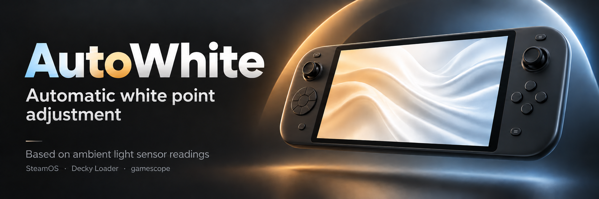

# AutoWhite

[](https://github.com/GaricST/AutoWhite/releases)
[](LICENSE)
[](#requirements)
[](https://github.com/SteamDeckHomebrew/decky-loader)

**English** · [Русский](README.ru.md)

A [Decky Loader](https://github.com/SteamDeckHomebrew/decky-loader) plugin that keeps the
**display white point in step with the ambient light**: warmer when the room is dark,
neutral in bright light. Brightness is never touched — only the colour temperature of white.

The idea is the same as Apple's **True Tone** on the iPhone and iPad: the display's white
balance follows the light in the room. AutoWhite brings that behaviour to SteamOS handhelds
through gamescope's virtual white point — no schedule, no manual switching.

## What it does

The plugin reads the handheld's ambient light sensor (ALS) and drives gamescope's virtual
white point atom `GAMESCOPE_DISPLAY_VIRTUAL_WHITE` (CIE 1931 x/y):

| Illuminance | White point |
|---|---|
| below 15 lx | warmest (up to 0.3750, 0.3750) |
| 15 … 250 lx | smooth blend from warm to neutral |
| above 250 lx | neutral D65 (0.3128, 0.3292) |

## Features

- **Sensor-driven** — the ambient light sensor sets the white point automatically; no
  schedule, no manual switching
- **Warm in the dark, neutral in bright light** — the point glides to the target
  exponentially (0.2 s tick, sensor polled once a second), so flipping a light switch does
  not produce a visible jump
- **Applies immediately at boot** — Decky loads the plugin at startup and the white point
  is set before the panel is ever opened
- **Enable / disable toggle** — switching the plugin off restores the neutral D65 point
- **Cooler — Warmer slider** — how warm the dark end becomes (0…100 %)
- **Live status** — current illuminance and the current white point
- **English / Russian UI**, chosen automatically from the system language
- **Self-contained** — no daemons, no network, no dependency on other plugins

## How it works

| What | Where |
|---|---|
| Ambient light | `/sys/bus/iio/devices/iio:device*` where `name` is `als`; channels `in_illuminance_raw` / `in_intensity_both_raw` |
| White point | gamescope root atom `GAMESCOPE_DISPLAY_VIRTUAL_WHITE` — two CARDINALs holding the float32 bits of x and y |
| Writing it | `runuser -u deck -- env DISPLAY=:0 xprop -root -f GAMESCOPE_DISPLAY_VIRTUAL_WHITE 32c -set … "bits_x, bits_y"` |
| Settings | `$DECKY_PLUGIN_SETTINGS_DIR/settings.json` |
| Logs | `$DECKY_PLUGIN_LOG_DIR` (one file per plugin start) |

Decky plugins run as **root**, while the gamescope X server belongs to user `deck` — a plain
`xprop` from root fails with `Authorization required`. That is why the atom is written
through `runuser -u deck`.

Dark-end mapping: `warm = NEUTRAL + (max_warm − NEUTRAL) × warmth`, `NEUTRAL = (0.3128, 0.3292)`,
`max_warm = 0.375`, and `t = clamp((lux − 15) / (250 − 15))` blends warm → neutral.

## Panel

| Item | What it does |
|---|---|
| **Enabled** | master switch |
| **Cooler — Warmer** | 0…100 % — the maximum warmth reached in the dark |
| **State** | current illuminance and the current white point |

## Installation

### One command (SteamOS Desktop → Konsole)

```bash
curl -fsSL https://raw.githubusercontent.com/GaricST/AutoWhite/main/install.sh | sh
```

The script downloads the current version, copies it into `~/homebrew/plugins/AutoWhite`
and restarts Decky. Re-run the same command to update.

### Through Decky

1. Install [Decky Loader](https://github.com/SteamDeckHomebrew/decky-loader).
2. Download `AutoWhite-<version>.zip` from Releases.
3. Decky → **Settings** → **General** → **Install plugin from file** → pick the ZIP.
4. Open **AutoWhite** in the Decky sidebar.

### From a checkout

```bash
./install.sh
```

The plugin registers the `root` flag, because it writes an X property and reads sysfs.

## Requirements

- Decky Loader
- A gamescope session (SteamOS / SteamOS-like handheld)
- `xprop` and `runuser` (present on SteamOS)
- An ambient light sensor exposed through IIO — without one the plugin simply idles and
  shows "sensor not found"

## Compatibility

Verified on **Lenovo Legion Go 2** (SteamOS). Any handheld that exposes an `als` IIO device
and runs gamescope should work; other devices are untested.

## Repository layout

```
plugin.json          Decky manifest (name, version, entry points)
main.py              backend: sensor read, white-point maths, gamescope write, panel API
dist/index.js        frontend bundle (Decky panel UI), committed as-is — no build step
tests/test_logic.py  unit tests: white-point maths, smoothing, settings sanitisation
assets/icon.svg      plugin icon
img/banner-en.png    header image (English) for this README
img/banner-ru.png    header image (Russian) for README.ru.md
install.sh           install / update from this folder on the device
logs/                sample logs from the development device
```

## Tests

```bash
python3 tests/test_logic.py
```

The tests stub the `decky` module, so they run anywhere — no handheld required. They cover
the white-point maths (dark/bright thresholds, D65, warmth scaling), the exponential
smoothing step and settings sanitisation.

## Similar projects

Checked on 2026-10-10 — no direct equivalent was found. The closest projects:

| Project | What it does | How AutoWhite differs |
|---|---|---|
| SteamOS **Night Mode** (built-in) | warms the screen manually or on a schedule | no ambient light sensor; the user sets it by hand |
| [vibrantDeck](https://github.com/libvibrant/vibrantDeck) | saturation and gamma | no white point, no sensor |
| [SDH-AutoNightMode](https://github.com/KingShibe/SDH-AutoNightMode) | night mode by local sunset/sunrise | deprecated (SteamOS 3.3 added it natively); schedule, not sensor |
| [decky-plugin-from-dusk-till-dawn](https://github.com/IvanKarpan/decky-plugin-from-dusk-till-dawn) | night-mode scheduler by sunset/sunrise | schedule, not sensor |
| [steamdeck-gamma](https://github.com/sweetbbak/steamdeck-gamma) | gamma and red-shift night mode | gamma/red shift, manual |
| [LeGo2BrightnessFix](https://github.com/Rayekkk/LeGo2BrightnessFix) | brightness slider fix and panel calibration for the Legion Go 2 | brightness and per-panel calibration; no ALS-driven white point |
| [LegionGo2Companion](https://github.com/Rayekkk/LegionGo2Companion) | TDP, brightness, HDR, lighting, gyro in one overlay | no ambient-light-driven white point |
| HHD (Handheld Daemon) | TDP, RGB, buttons, device configuration | no display white point control |

AutoWhite is the only one that closes the loop: **ALS → white point, continuously and
automatically**, without a schedule and without user input.

## Notes and limitations

- If Steam's own night mode is enabled, both effects add up — AutoWhite does not read
  `GAMESCOPE_COLOR_NIGHT_MODE`.
- `settings.json` keeps only known keys: anything left over from older builds is ignored
  on load and dropped on the next save.
- Brightness is deliberately untouched: use the system slider or a brightness plugin.
- The sensor must be exposed to SteamOS. On some firmware revisions it may report 0 lx
  until the panel is active.

## Credits

The idea was born while working on Legion Go 2 brightness plugins; thanks to the
[LeGo2BrightnessFix](https://github.com/Rayekkk/LeGo2BrightnessFix) project for proving
that gamescope atoms can be written from a Decky plugin.

## License

MIT — see [LICENSE](LICENSE).
