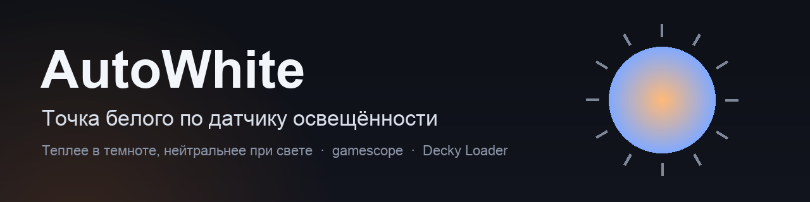

# AutoWhite

[](https://github.com/GaricST/AutoWhite/releases)
[](LICENSE)
[](#требования)
[](https://github.com/SteamDeckHomebrew/decky-loader)

[English](README.md) · **Русский**

Плагин для [Decky Loader](https://github.com/SteamDeckHomebrew/decky-loader), который
подстраивает **точку белого экрана под освещение в комнате**: в темноте картинка теплее,
при ярком свете — нейтральнее. Яркость при этом не меняется — только цветовая температура
белого.

## Что делает

Плагин читает датчик освещённости консоли (ALS) и управляет виртуальной точкой белого
gamescope — атомом `GAMESCOPE_DISPLAY_VIRTUAL_WHITE` (координаты x/y в CIE 1931):

| Освещённость | Точка белого |
|---|---|
| ниже 15 лк | самая тёплая (до 0.3750, 0.3750) |
| 15 … 250 лк | плавный переход от тёплой к нейтральной |
| выше 250 лк | нейтральная D65 (0.3128, 0.3292) |

## Возможности

- **Работа по датчику** — освещённость задаёт точку белого автоматически, без расписания
  и без ручных переключений
- **Тепло в темноте, нейтрально при свете** — точка плавно скользит к цели по
  экспоненте (шаг 0.2 с, опрос датчика раз в секунду), поэтому включение света не даёт
  заметного рывка
- **Включается вместе с консолью** — Decky запускает плагин при старте, точка белого
  ставится до открытия панели
- **Тумблер «Включено»** — при выключении возвращается нейтральная D65
- **Ползунок «Холоднее — Теплее»** — насколько тёплым становится экран в темноте (0…100 %)
- **Статус** — текущая освещённость и текущая точка белого
- **Русский / английский интерфейс** — выбирается автоматически по языку системы
- **Самодостаточность** — без демонов, сети и зависимостей от других плагинов

## Как это устроено

| Что | Где |
|---|---|
| Освещённость | `/sys/bus/iio/devices/iio:device*`, устройство с `name = als`; каналы `in_illuminance_raw` / `in_intensity_both_raw` |
| Точка белого | корневой атом gamescope `GAMESCOPE_DISPLAY_VIRTUAL_WHITE` — два CARDINAL с float32-битами x и y |
| Запись | `runuser -u deck -- env DISPLAY=:0 xprop -root -f GAMESCOPE_DISPLAY_VIRTUAL_WHITE 32c -set … "bits_x, bits_y"` |
| Настройки | `$DECKY_PLUGIN_SETTINGS_DIR/settings.json` |
| Логи | `$DECKY_PLUGIN_LOG_DIR` (файл на каждый запуск плагина) |

Плагины Decky работают от **root**, а X-сервер gamescope принадлежит пользователю `deck`,
поэтому прямой `xprop` от root падает с `Authorization required`. Именно поэтому запись
идёт через `runuser -u deck`.

Расчёт: `warm = NEUTRAL + (max_warm − NEUTRAL) × warmth`, где `NEUTRAL = (0.3128, 0.3292)`,
`max_warm = 0.375`; `t = clamp((lux − 15) / (250 − 15))` смешивает тёплую и нейтральную точки.

## Панель

| Пункт | Что делает |
|---|---|
| **Включено** | главный тумблер |
| **Холоднее — Теплее** | 0…100 % — максимальная теплота в темноте |
| **Состояние** | текущая освещённость и текущая точка белого |

## Установка

### Одной командой (рабочий стол SteamOS → Konsole)

```bash
curl -fsSL https://raw.githubusercontent.com/GaricST/AutoWhite/main/install.sh | sh
```

Скрипт скачает текущую версию, положит её в `~/homebrew/plugins/AutoWhite` и перезапустит
Decky. Для обновления — та же команда.

### Через Decky

1. Установите [Decky Loader](https://github.com/SteamDeckHomebrew/decky-loader).
2. Скачайте `AutoWhite-<версия>.zip` из Releases.
3. Decky → **Настройки** → **Общие** → **Установить плагин из файла** → выберите ZIP.
4. Откройте **AutoWhite** в боковой панели Decky.

### Из папки с исходниками

```bash
./install.sh
```

Плагин регистрирует флаг `root`: он пишет X-свойство и читает sysfs.

## Требования

- Decky Loader
- Сессия gamescope (SteamOS или совместимая система)
- `xprop` и `runuser` (в SteamOS есть)
- Датчик освещённости, доступный через IIO — без него плагин просто ждёт и показывает
  «датчик не найден»

## Совместимость

Проверено на **Lenovo Legion Go 2** (SteamOS). Ожидается работа на других консолях, где
есть IIO-устройство `als` и gamescope; остальные устройства не тестировались.

## Структура репозитория

```
plugin.json          манифест Decky (имя, версия, точки входа)
main.py              backend: чтение датчика, расчёт точки белого, запись в gamescope, API панели
dist/index.js        собранный frontend панели, коммитится как есть — шаг сборки не нужен
tests/test_logic.py  тесты: расчёт точки белого, сглаживание, санитизация настроек
assets/icon.svg      иконка плагина
img/banner-ru.png    картинка-шапка (русская) для этого README
img/banner-en.png    картинка-шапка (английская) для README.md
install.sh           установка / обновление из этой папки на консоли
logs/                примеры логов с устройства разработки
```

## Тесты

```bash
python3 tests/test_logic.py
```

Тесты подставляют заглушку `decky`, поэтому запускаются на любом компьютере — консоль не
нужна. Проверяются расчёт точки белого (пороги темно/светло, D65, масштаб теплоты), шаг
плавного сглаживания и санитизация настроек.

## Похожие проекты

Проверено 10.10.2026 — прямых аналогов не найдено. Ближайшие проекты:

| Проект | Что делает | Чем AutoWhite отличается |
|---|---|---|
| Штатный **ночной режим SteamOS** | делает экран теплее вручную или по расписанию | нет датчика освещённости; всё задаёт пользователь |
| [vibrantDeck](https://github.com/libvibrant/vibrantDeck) | насыщенность и гамма | нет точки белого и датчика |
| [SDH-AutoNightMode](https://github.com/KingShibe/SDH-AutoNightMode) | ночной режим по восходу/закату | устарел (SteamOS 3.3 добавила это штатно); расписание, а не датчик |
| [decky-plugin-from-dusk-till-dawn](https://github.com/IvanKarpan/decky-plugin-from-dusk-till-dawn) | планировщик ночного режима по закату/восходу | расписание, а не датчик |
| [steamdeck-gamma](https://github.com/sweetbbak/steamdeck-gamma) | гамма и red-shift ночной режим | гамма/сдвиг, вручную |
| [LeGo2BrightnessFix](https://github.com/Rayekkk/LeGo2BrightnessFix) | исправление ползунка яркости и калибровка панели Legion Go 2 | яркость и калибровка; автоподстройки точки белого по датчику нет |
| [LegionGo2Companion](https://github.com/Rayekkk/LegionGo2Companion) | TDP, яркость, HDR, подсветка, гироскоп в одном оверлее | нет управления точкой белого по свету |
| HHD (Handheld Daemon) | TDP, RGB, кнопки, настройка устройства | нет управления точкой белого |

AutoWhite — единственный, кто замыкает цикл: **датчик → точка белого, непрерывно и
автоматически**, без расписания и участия пользователя.

## Особенности и ограничения

- Если включён штатный ночной режим Steam, оба эффекта складываются — AutoWhite не читает
  `GAMESCOPE_COLOR_NIGHT_MODE`.
- В `settings.json` попадают только известные ключи: всё лишнее от старых версий
  игнорируется при загрузке и отбрасывается при сохранении.
- Яркость не трогается специально: используйте системный ползунок или плагин яркости.
- Датчик должен быть доступен SteamOS. На некоторых прошивках он отдаёт 0 лк, пока
  экран не активен.

## Благодарности

Идея родилась в работе над плагинами яркости для Legion Go 2; спасибо проекту
[LeGo2BrightnessFix](https://github.com/Rayekkk/LeGo2BrightnessFix) за доказательство того,
что атомы gamescope можно писать из плагина Decky.

## Лицензия

MIT — см. [LICENSE](LICENSE).
